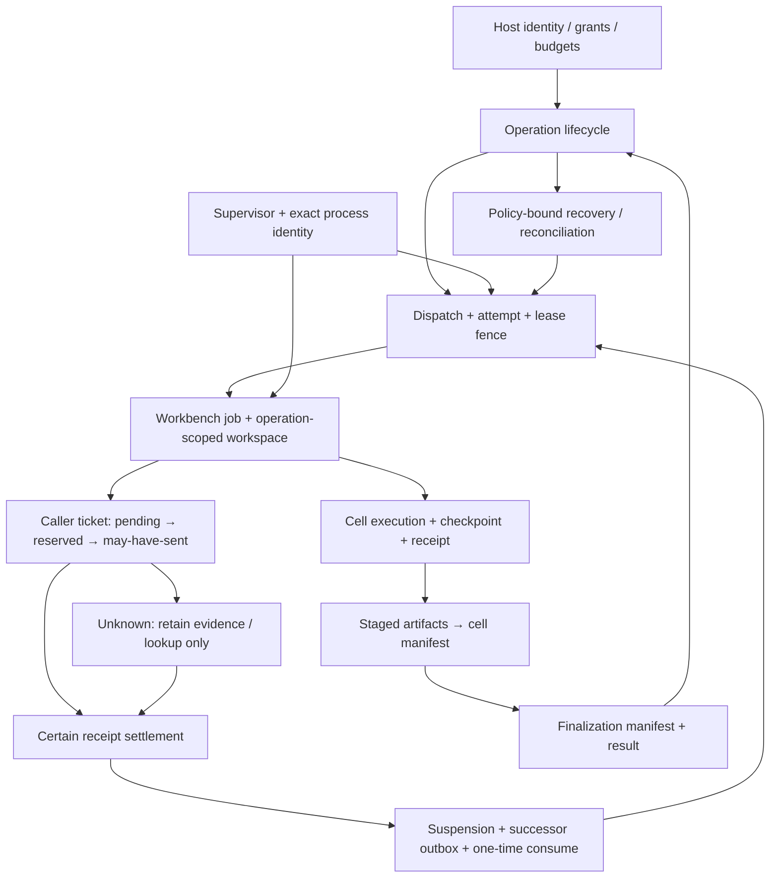

# AAR 顯性／隱性狀態機盤點與有據修正

## 範圍與證據尺度

本次以 `063a5b05690191ffde404bad63a71cb0576a9063`（`v0.6.1a0` 的來源）為基準，盤點 `src/aar` 的 89 個 Python 來源檔，使用該 worktree 的 CodeGraph 導航，再以原始碼、SQL、契約與回歸測試確認。沒有使用停在舊支線的索引推定目前產品。

以下是 **30 個語義家族：8 顯性、10 隱性、12 混合**，不是宣稱只有 30 個 runtime instance、窮舉了每個旗標組合，或證明所有並行路徑均可達／不可達。

- **顯性**：以 enum、Literal、契約或資料列欄位直接表達階段。
- **隱性**：由旗標、計數、receipt／manifest 是否存在、資源所有權或判定流程導出狀態。
- **混合**：持久狀態與易失程序、lease、generation、revision 或投影必須共同判斷。
- 契約列出的狀態不等於執行流程一定寫入；測試檔出現在清冊表示覆蓋入口，不表示本輪全部執行。
- Source／測試通過不代表 wheel、安裝、live pickup、provider 資格、正式比較或 publication 通過。這輪未部署、未重啟 live、未送 provider request。

## 一、全貌：不是一個大 enum

三種「看似完成」必須分開：

1. worker 回了 receipt；
2. 內層 cell／ticket／manifest 已提交；
3. outer operation 經正確 fence 終結。

同理，`cancel_requested` 不是外部工作已取消；`send_started` 是保守的 may-have-sent 標記，不是 provider 已收件；`waiting_external` 投影為 outer `accepted` 不代表可以重新送同一個實體呼叫。

## 二、清冊

每項列出狀態／主要轉移、owner／guard 與覆蓋入口。原始碼函式名稱是主要定位；基準行號會隨後續修改移動。

### 核心執行與恢復

1. **operation-lifecycle〔顯性〕**
   - `accepted → running → succeeded/failed/cancelled/timed_out/indeterminate`；和解可從 indeterminate 得出有證據的結果。certainty、record revision、runtime generation 是另外的維度。
   - Owner：`runtime/registry.py::OperationRegistry` 的 accept／begin／succeed／fail／cancel／time_out／_transition；同交易保存 events。重啟重綁 accepted，running 轉 indeterminate，不推論成功。
   - 覆蓋：`test_reference_host.py`、`test_continuity_registry.py`。

2. **dispatch-attempt-lease〔混合〕**
   - dispatch `queued/running/completed/parked/cancelled`；attempt、lease epoch、owner、expiry、runtime／dispatcher generation 共同決定誰可提交。claim、heartbeat、finish、park／recovery 是不同事件。
   - Owner：`registry.py`、`dispatcher.py`；過期或舊 owner 的寫入被 fence。wait timeout 不等於取消。attempt 公開模型與資料列狀態的差異見後述缺口。
   - 覆蓋：`test_dispatcher.py`、`test_continuity_registry.py`、`test_durable_rlm.py`。

3. **cancellation-control〔混合〕**
   - `cancellation_requested`、`control_revision`、request time／reason 與 outer state 分離；queued 可直接取消，running 由執行者觀察或恢復分類。
   - Owner：`registry.py::request_cancel/cancel_queued_dispatch`、`continuity.py`。一般 operation cancel 不取代 program interrupt。
   - 覆蓋：`test_continuity_registry.py`、`test_durable_workspace.py`。

4. **recovery-policy-boundary〔顯性〕**
   - decision 包含 `resume_native/start_successor/restore_checkpoint/reconcile_effect/needs_user/terminal_from_receipt/quarantine`；受 policy、checkpoint／step boundary、環境、累積 budget／deadline 約束。
   - Owner：`continuity_models.py`、`runtime/continuity.py`、registry successor admission。未解 broker call 不得被一般 replay 掩蓋。
   - 覆蓋：`test_recovery_policy.py`、`test_durable_rlm.py`、`test_durable_workspace.py`。

5. **scalar-workspace〔隱性〕**
   - session／generation／revision + JSON map + operation receipt 是否存在構成狀態；mutation 遞增 revision，exact replay 讀原 receipt。
   - Owner：`runtime/workspace.py::DeterministicWorkspace`；state update 和 receipt 同交易，失敗不能留下半份提交。
   - 覆蓋：`test_reference_host.py`。

6. **programmable-workspace〔混合〕**
   - namespace、generation／revision、closed、running、lost／suspended 與 receipts；成功或 user-code exception 都可能推進 revision，不能假設失敗 rollback。
   - Owner：`runtime/programming.py`、`ipython_backend.py`；per-state lock、exact handle、worker receipt；checkpoint 只有明定 portable subset，restore 建新 generation。
   - **本次修改**：missing workspace 也會走 finally 清除 running marker。覆蓋：`test_programmable_workspace.py`、`test_ipython_workspace.py`、新增 recovery-edge regression。

7. **managed-worker-lifecycle〔混合〕**
   - register／ready／busy／terminating／terminal disposition，綁 exact process identity、workspace／runtime generation 與 heartbeat。
   - Owner：`worker_manager.py`、registry worker bindings；PID 相同不代表同一程序，unknown identity 不能冒充已終止。
   - 覆蓋：`test_worker_manager.py`、`test_process_identity.py`。

8. **legacy-rlm〔混合〕**
   - RlmStore job state、step index／receipt 與 outer operation 是不同資料；每個 durable step、broker receipt、terminal receipt 之間有不同 crash boundary。
   - Owner：`runtime/rlm.py`、`continuity.py`；保留已提交 steps，只有明確安全邊界才續跑。
   - 覆蓋：`test_rlm.py`、`test_durable_rlm.py`。

### 宿主、安裝與公開服務

9. **supervisor-owner-publication〔混合〕**
   - discovery absent／stale／live／unavailable；owner starting／recovering／ready／draining／stopped／reconcile-required；lifecycle journal 只是投影。
   - Owner：`supervisor.py`、`ownership.py`、`process_identity.py`；OS owner lock、exact native identity、generation-specific control files。正常生命周期保留 generation 證據，不刪可能屬於 successor 的路徑。
   - 覆蓋：`test_supervisor_cleanup.py`、`test_supervisor_integration.py`。

10. **ephemeral-frontend-attachment-grant-control〔隱性〕**
    - discovery／credential verified → connected／authenticated／attached → disconnected；grant control 在送出後失聯可為 indeterminate。
    - Owner：`supervisor_client.py`、`supervisor.py`；attachment 綁 generation／digest／deadline，frontend 離開不取消 durable operation。
    - 覆蓋：`test_hermes_host_adapter.py`、`test_supervisor_client.py`。

11. **managed-exact-child-cleanup〔顯性〕**
    - `ACTIVE → TERMINATING → TERMINAL/UNRESOLVED`；多個 terminalizer 共用同一個已知結果。
    - Owner：`process_identity.py::ExactChild`；保留 spawn-bound handle，identity／signal／wait 不可確認時 fail closed，不退回一般 PID kill。
    - 覆蓋：`test_process_identity.py`。

12. **activation-generation-and-session-authority〔混合〕**
    - install preflight → generation grant set published → current activation；session grant issue／accept／revoke 另有權限狀態。
    - Owner：`_activation_store.py`、`provider_ready_startup.py`、`provider_ready_activation.py`、`_session_grants.py`。durable generation 是 fence，in-memory current 只是投影；exact binding、no-replace、readback。
    - 覆蓋：`test_provider_ready_activation.py`、`test_activation_generation_restart.py`、`test_hermes_host_adapter.py`。session-grant 全部交錯未窮舉。

13. **clean-install-publication-authority〔混合〕**
    - absent target → owned staging → verified staged evidence → atomic no-replace publication → verified readback；rename 後不確定不能當 pre-publication 清理。
    - Owner：`installer.py`、`_install_fs.py`、`operator.py`；target／directory ownership、candidate／intent／receipt digest。未知內容不 destructively clean。
    - 覆蓋：`test_runtime_installer.py`、`test_install_fs_ownership.py`、`test_install_sqlite_authority.py`。

14. **codex-hermes-launcher〔隱性〕**
    - existing discovery → reuse，或 startup lock → recheck → spawn exact child → ready／failure cleanup；Hermes handoff 還需 live capability 與 persisted binding 一致。
    - Owner：`compat/codex_mcp.py`、`codex_setup.py`、`hermes_mcp.py`。launcher 不是 runtime owner；不從可見設定推論 provider CAS authority。
    - 覆蓋：`test_codex_mcp_launcher.py`、`test_codex_setup.py`、`test_hermes_host_adapter.py`；post-spawn version 分支見缺口。

15. **public-oidc-authentication〔隱性、判定流程〕**
    - untrusted bearer → valid identity／rejected；signature／issuer／audience／expiry／scope 必須一起成立。這是每請求導出的決策，不是另存一個 mutable auth phase。
    - Owner：`mcp/public_auth.py`、`public_server.py`；tenant key 從 issuer／subject 導出，不把 bearer 變成持久 state。
    - 覆蓋：`test_public_auth.py`、`test_public_mcp_server.py`；本輪沒有外部 OIDC／JWKS 實跑。

16. **public-tenant-runtime-leases〔隱性〕**
    - pool open／closed，entry absent／present／closing，lease count、LRU、database owner lock。
    - Owner：`mcp/public_runtime.py`；LRU eviction 僅選 idle lease=0。pool.close 與 active lease 的契約仍需澄清，不能把 eviction 保護套成 shutdown 已驗證。
    - 覆蓋：`test_public_runtime.py`。

17. **public-rlm-caller-delegated-command〔顯性〕**
    - job `pending_model_call → awaiting_caller_result → succeeded/failed/indeterminate`；取消後 `cancel_requested`，late receipt 只 retained observation、不產生下一個 call。
    - Owner：`mcp/public_rlm.py`、`public_rlm_models.py`；tenant isolation、ticket／route／revision、bounded append-only command replay；外部 model execution 歸 host。
    - 覆蓋：`test_public_rlm.py`、`test_public_rlm_models.py`。此 public job 與本機 workbench caller ticket 不是同一機器。

### Workbench、broker、證據與資源關閉

18. **workbench-job-phase〔顯性〕**
    - 契約列 12 態；目前主要路徑 `accepted → preparing_workspace → running → finalizing → succeeded`，或 `running → waiting_external → accepted → successor`；failure／cancel／timeout／park 依證據分支。
    - Owner：`rlm_workbench.py::RlmWorkbenchCoordinator` 與 registry。`checkpointing` 在契約存在，但本輪未找到獨立 phase writer；不可宣稱它是已實作的必經階段。
    - **本次修改**：prepare 前後重驗 job／control 並要求成對 CAS；覆蓋 `test_state_machine_invariants.py`、`test_rlm_workbench.py`。

19. **workbench-cell-commit〔混合〕**
    - cell SQL 契約列 `prepared/running/suspended/lost_before_commit/committed/failed/cancelled/discarded`；目前主要路徑使用其中的 prepare／run／suspend／commit／loss 邊界，不能只由可接受字串推定每個 writer 都已實作。另有 pre／post revision、checkpoint、source／result digest；committed receipt 不必是成功執行。
    - Owner：`rlm_workbench.py::_execute_cell/_resume_successor_cell`、registry、`artifact_publication.py::commit_cell`；unknown worker／receipt 不得假裝 rollback。
    - 覆蓋：`test_workbench_cell_feedback.py`、`test_rlm_workbench.py`、`test_artifact_publication.py`。

20. **caller-work-ticket〔顯性〕**
    - `pending → send_reserved → send_started → settled_success/settled_failure/outcome_unknown/cancel_requested`；明確未送才能回 pending／cancelled_before_send；互斥終態證據 quarantine。
    - Owner：`caller_work.py::CallerWorkRepository`；ticket revision、claim／physical-attempt fence、control／suspension／deadline；durable command receipts 綁 exact request bytes。
    - **本次修改**：unknown 保留 unknown／cancel_requested，不發布確定終態；後來確定 receipt 可和解。覆蓋新增 recovery-edge 與 `test_caller_work_lifecycle.py`。

21. **caller-settlement-successor〔混合〕**
    - suspension `pending/settled/cancelled/parked`；outbox `pending/prepared/consumed`；rebind `prepared/committed/aborted/consumed`。
    - Owner：caller settlement transaction + registry successor CAS；outbox 才是 durable 待辦，notification 只是可重建喚醒。unknown 不產生 outbox，late receipt 不能復活 terminal outer operation。
    - 覆蓋：`test_provider_ready_planner_runtime.py`、`test_rlm_workbench.py`、新增 recovery-edge regression。

22. **broker-call-reservation〔混合〕**
    - `started/rejected_before_send/succeeded/failed`；started 的 usage 是 admission reservation，非 committed usage 或帳單。
    - Owner：`brokers.py::BrokerJournal`；持久 intent、request digest、authority、budget；unknown started 只能和解，不因沒有回應就釋出額度重送。
    - **本次修改**：先取得 DB writer 再讀 admission，保留執行中額度；未和解的 quarantine／compensation 不再允許以新 key 取得有額度工作。零額度診斷／提案與 exact successful replay 維持可用。覆蓋新增五額度／雙連線／強制交錯／和解分支回歸與 `test_broker_facade.py`。

23. **model-execution-journal〔顯性〕**
    - `provider_send_started → provider_terminal_receipt → result_committed`，或 provider_call_indeterminate／provider_failed_certain／各種 receipt／route quarantine。
    - Owner：`model_broker.py::ModelExecutionJournal`；operation／request／route／response／usage digest。provider receipt 後的本機提交可復原，不代表重送 provider。
    - 覆蓋：`test_model_broker_registry.py`、`test_workbench_accounting.py`。不能與 ticket 欄位合成一欄。

24. **model-registry-gateway-close〔隱性〕**
    - `_closing/_closed/_closed_broker_ids`，各 gateway 的 close 旗標。close 阻止新 bind／resolve、唯一 driver 關一次、失敗保留 retry 進度。
    - Owner：`model_broker.py::ModelBrokerRegistry`、`providers/gateway.py`、`mcp_sampling.py`；close lock 與 object identity，不是 model-call 結果狀態。
    - 覆蓋：`test_model_broker_registry.py`、`test_mcp_sampling_gateway.py`。

25. **artifact-publication〔混合〕**
    - stage `staged/committed/discarded`；cell／finalization manifest absent／present；job `finalizing/succeeded` 決定 public visibility。
    - Owner：`artifact_publication.py`；stage 不等於發布，cell commit 與 finalization 各守其 exact identity／digest。public resolve 同 snapshot 驗 membership 與 bytes；native 未發布不退回 legacy。
    - 覆蓋：`test_artifact_publication.py`、`test_workbench_artifact_workflow.py`、`test_workbench_cell_feedback.py`。

26. **caller-driver-send-guard〔顯性〕**
    - `prepared → mark_in_progress → send_started → send_observed`，或 mark_unconfirmed／outcome_unknown。
    - Owner：`integrations/caller_driver.py::CallerDriverSendGuard`；本機 lock 保護 one-shot，ready 綁 nonce／ticket／request／physical attempt。它不提供跨重啟 replay 權限。
    - 覆蓋：`test_caller_driver_conformance.py`。

27. **sqlite-close-fence〔隱性〕**
    - `open → closing → closed` + active transaction count；close 拒絕新入場並等舊交易結束。
    - Owner：`sqlite_repository.py::SQLiteConnectionFactory`；thread-owned connection、transaction finally、condition。不能只剩一個 closed boolean。
    - 覆蓋：`test_broker_repository_concurrency.py`。

28. **workspace-broker-frame-journal〔隱性〕**
    - frame identity absent／started／succeeded，sequence／idempotency／attempt／receipt 決定可否 replay。
    - Owner：`ipython_backend.py::WorkspaceBrokerSession`；exact frame 讀 receipt，不同 bytes 或 sequence 綁同 identity 拒絕；started 無 receipt 保留 indeterminate。
    - 覆蓋：`test_workspace_broker_protocol.py`。共享表名不等於與 BrokerJournal 共享所有 receipt 語義。

29. **immutable-assets-outcome〔隱性〕**
    - content-addressed body／manifest／event 是否存在；episode outcome `unknown/observed`；prepare-only preview 不是 active。
    - Owner：`assets.py::AdaptiveAssetStore`、`asset_models.py`；dependency／event closure 先驗後原子 import、one outcome per episode；缺 outcome 不代表失敗或 zero reward。
    - 覆蓋：`test_assets.py`、`test_ar23_regressions.py`。這是 evidence catalog，不是 serving activation controller。

30. **reference-host-drain〔隱性〕**
    - `_closing/_runtime_resources_closed/_closed` + durable_admission_depth；先 drain runtime resources，保留 registry 可寫 terminal receipt，最後才 close registry。
    - Owner：`reference_host.py::drain_runtime_resources/close`；lifecycle lock、關閉順序與部分失敗保留；不能將三旗標機械合併。
    - 覆蓋：`test_minimum_control_ownership.py`、`test_supervisor_cleanup.py`、`test_runtime_ownership.py`。

## 三、本次實際改變的運作邏輯

### A. 執行中工作也占 admission 額度

- **之前**：budget 查詢排除 `started`。第一筆仍執行時，第二筆可當作前面沒有占額；不同 journal connection 還可能在取得寫入鎖前讀到舊總額。
- **之後**：在 admission 讀取前取得 SQLite writer；以已分類 usage + 未結束 reservation 檢查下一筆。exact successful replay 仍不再扣一次；`usage()` 仍不把 reservation 報成已提交用量。
- **證據**：五額度 × 共用／分開連線的 10 個 fail-first cases，加一個強制兩連線 admission 交錯的 discriminator。這不是「已知實際 billing」或任意 actual-token 超額不可能的宣稱。

### B. worker 建立完成，不代表仍有權發布 handle

- **之前**：worker create 在交易外執行；期間取消／逾時可能改變 job/control，後續 UPDATE 零列也未檢查，仍可回傳 handle 或讓 revision 不一致。
- **之後**：prepare 與 publish 各在交易內檢查非 terminal、未取消、job/control revision 一致；job 與 control 兩個 CAS 都必須成功，否則整筆 rollback 並拒絕。建立後失權不擅自 kill 可能共用的 generation，仍由原 backend owner 做正常 cleanup。
- **證據**：create 期間 deadline／cancel 兩種交錯，及開始前已有 cancel 的三個 fail-first cases；原 exact retry／並行 admission 測試仍通過。

### C. 未知結果不再被錯判為確定失敗

- **之前**：`outcome_unknown` 落入通用 else，變成 `settled_failure`，終結 suspension 並可能建立 successor；cancel_requested 也可能被覆蓋。
- **之後**：保留未知 candidate receipt；ticket 維持 outcome_unknown 或既有 cancel_requested，不寫 settlement digest／時間、不產生 outbox、不重送。後續 typed certain receipt 可解決同一次 physical attempt；未知與確定不是互斥終態衝突，兩份證據都保留。兩份真正互斥的確定 receipt 仍 quarantine。
- **證據**：send_started 與 cancel_requested 兩種前態都先 RED；unknown exact replay、無 successor、同一 send mark、後續某次確定成功及兩份證據保留均有斷言。沒有弱化 model journal／route receipt 要求。

### D. missing workspace 不再留下幽靈 running

- **之前**：先登記 running，`_state()` 在 try/finally 外拋 WorkspaceNotFound，running marker 永久殘留。
- **之後**：lookup 放入既有 finally 保護範圍；失敗也清 marker，沒有執行或提交的 operation 不被誤判仍在跑；成功 receipt 與 revision 語義不變。
- **證據**：missing workspace → 正確建立 workspace → 同一 operation 執行一次成功並 reconcile completed 的 fail-first regression。

### E. quarantine 不代表未知成本已歸零

- **之前**：既有 `record_unresolved_reconciliation` 的 quarantine／compensation 路徑可將 row 的 usage 投影歸零；即使第一個實體結果不明，不同 key 的下一筆工作仍可能通過額度檢查。
- **之後**：在同一個 admission 交易、exact successful replay 之後，檢查該 operation 是否有尚未 succeeded 的 quarantine／compensation；若有，拒絕新 **nonzero-budget** 工作，保持該 operation 的不確定權限封鎖，不以新 key 自動恢復。零額度的診斷／proposal 與既有成功 receipt replay 不受此額外 guard 阻擋。不把 reservation 寫成已確認帳單，也沒有重設或替換舊 receipt。
- **證據**：pending／quarantine／compensation 三分支；前者原本即被 reservation 阻擋，後兩者先 RED。修後三者都拒絕新增有額度呼叫，零額度 inspection 與 replay 仍成功。這個 guard 是最後修補批次，由主代理驗證，不冒稱為前一份獨立 review 已審過的 bytes。

沒有新增 durable table、schema revision、dispatcher、全域 enum framework 或另一個 authority owner；這輪是正確性／恢復性修正，沒有量測加速，故不宣稱效能提升。

## 四、驗證與保留缺口

以 JUnit testcase identity 去重並採最新結果，不把重跑加總當不同案例：目前 **238 個不同案例的最新結果通過**，其中 **20 個新增回歸案例**。最後受影響 shard `138 passed`；組合測試批次 `100 passed`，兩批 testcase identity 不重疊。組合批次在最後一個 quarantine guard 前執行，僅重用其未經 quarantine 新增有額度工作的既有路徑；最後 guard 的 broker／模型／caller／regression 邊界另已重跑。這不是一次完整 repository suite。

- 新增測試：`tests/test_state_machine_invariants.py`、`tests/test_state_machine_recovery_edges.py`。
- Ruff（四個修改的 source、兩個 regression 檔）及 `git diff --check` 通過。
- 首次 broker fixture 漏必填欄位、一次 recovery 測試拿舊 revision 查詢，均已修正；這些 harness failure 不計作產品缺陷 RED。
- 一輪獨立 Sol finding review 完成，六檔 fingerprint 前後一致，提出 SOL-01（未綁定 workspace 留存）與 SOL-02（既有 quarantine 預算缺口）。主代理核實並處置：SOL-02 以 E 的局部 guard 修正；SOL-01 依下述條件接受為可回收殘留風險。最後 guard 與加強的 owner-drain 斷言由主代理測試，沒有假稱 reviewer 重審或整包 release PASS。

### 有意保留／未宣稱解決

1. **attempt 模型與持久 row 的 state domain 不一致**：`OperationAttemptRecordV1.state` 使用 DispatchState；restart／expiry 可寫 indeterminate。已確認 source 差異，但目前 runtime 主要投影是 attempt ref，未證明現行公開 API 一定故障；需以實際 consumer 與 versioned-contract 策略決定，不默改已發布 schema。
2. **suspended IPython 的 health／reconcile 投影**：health 計 suspended 為 busy，reconcile 的 running 判斷未包含 suspended。source asymmetry 已確認；公開可達性與正確 projection 契約未在本輪實跑，保留精確邊界，不能直接視為 worker 真 lost。
3. **public tenant pool.close 與 active lease**：eviction 保護 lease=0，close 則關所有 entry。需澄清／驗證 request drain 契約，再決定 defer、reject 或等待；未擅自加入可能永久等待的關閉程序。
4. **Codex post-spawn discovery 版本分支**：一般 reuse 檢查 expected package version，post-spawn 接受另一 owner 的 helper 沒有同樣檢查；尚未證明實際競爭路徑及 downstream 防線，列為下一個 focused negative case，而非宣稱已修復。
5. 非 model caller observation（例如 child accepted／cancelled_certain、effect proposed）的完整語義映射、所有 session-grant 交錯、原生 Windows host、外部 OAuth／provider、安裝與 live pickup 不在這批執行證據內。
6. **SOL-01：失權後的未綁定 workspace 可能保留至 backend drain**。獨立 probe 確認這個 source 邊界；本輪不做 unconditional close，避免關掉 concurrent successful preparer 共用的 generation。取消／逾時回歸已加斷言：原 host 正常 close 後，實際 IPython state closed 且 child 已 terminal。風險為低頻、可回收的 process／memory／capacity 留存，不是模型重送或 publication 繞過；長生命 host 反覆遇到此交錯／出現 capacity 壓力時，需以 exact creation-ownership／既有 cleanup owner 做後續修復。未宣稱長生命 host 無資源留存。

**盤點完成不等於全面健康認證。** 本次接受的是列明的來源邏輯修正與受影響驗證，不是 release／live／formal evaluation 的 PASS。
